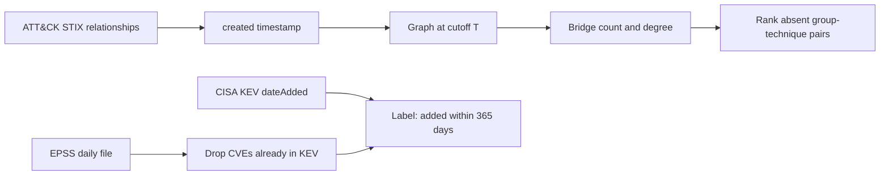

# Architecture

The encoder in the concept paper is a temporal GNN. The score here is the two graph statistics that survived a comparison with that GNN's obvious stand-in (a seven-feature logistic). Replacing the score with a PyTorch temporal GNN should keep the same cutoff code and the same JSON fields.
