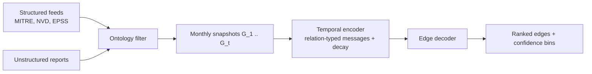

# Architecture

The checked-in encoder is a NumPy message-passing model with the same interfaces as the TGNN in the concept paper: per-relation aggregation, a temporal state, and an edge head `g(h_u, h_v, r)`. Swapping the encoder for a PyTorch Geometric temporal GNN does not change the benchmark harness.
