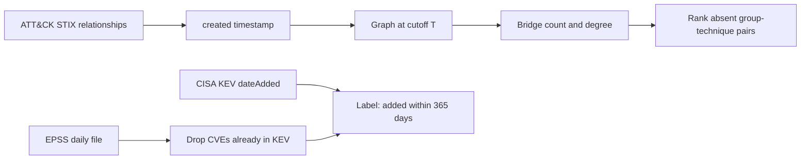

# Architecture

The encoder aggregates group–technique neighbors once per year and the decoder is DistMult, fit on pairs dated on or before the cutoff. Static, LSTM, and attention baselines use the same candidates.
